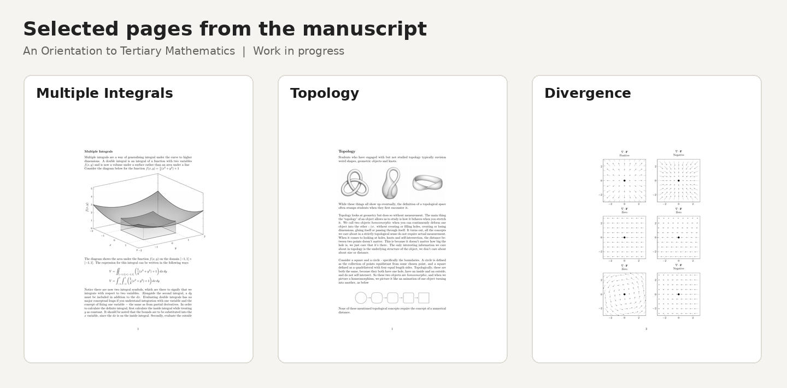

# An Orientation to Tertiary Mathematics

**Independent mathematics textbook — work in progress**  
Dylan McHatton · Australian National University mathematics graduate

An introductory text developed as an orientation to tertiary mathematics, aimed at high achieving secondary-school students and first year university students. It introduces each key subject area of tertiary mathematics in a way that is accessible to the intended demographic. It aims to bridge the gap between university level textbooks, which often assume a high level of mathematical maturity, and superficial explanations like 
- "Group theory is the study of symmetry" 
- "Algebraic topology is where a donut and a coffee mug are the same"
- "Real analysis is calculus with rigorous proofs"

Each subject area establishes a mathematical objective, often times appealing to geometric intuition, then introducing the relevant algebra. Students should finish reading this book and have a good understanding of what each subject area studies, what the content looks like and how it connects to other subject areas. I also want to introduce students to some of the algebra, but without turning the text into a textbook. I envision a reader of this text looking at mathematics that's left on a whiteboard and being able to confidently identify the subject area - akin to how you can distinguish French, Mandarin and Arabic without understanding the languages

The excerpts below show a few of the ways the text introduces material in calculus and pure mathematics. **These are draft samples, not chapters from a published edition.**

## Read the sample pages

**[View all 12 sample pages (PDF)](Sample_Pages.pdf)**

| Sample | What it demonstrates |
| --- | --- |
| [Multiple integrals (4 pages)](multiple-integrals.pdf) | Moving from single-variable integration to double integrals, including non-rectangular domains and original 3D figures |
| [Topology (4 pages)](topology.pdf) | Moving from geometric intuition to open sets, unions and intersections, and the definition of a topological space |
| [Divergence (4 pages)](divergence.pdf) | Using a water-flow analogy to motivate divergence, then moving to analytic notation, vector-field illustrations and heat maps |

## About the book

The text aims to provide a sense of clarity, direction and preparation for students intending to study mathematics at university. In particular, there is very little exposure to pure mathematics (real analysis, abstract algebra) prior to the study of university, and students may stay distant from the study of pure mathematics due to their unfamiliarity, preconceived notions or lack of awareness of the area.

Topics in development include linear algebra, calculus (incl. complex analysis & differential geometry), real analysis, abstract algebra, probability, number theory, and introductions to more advanced topics like algebraic topology and algebraic geometry

The figures in these samples combine LaTeX typesetting with TikZ/PGFPlots diagrams, and a select few illustrations generated with ChatGPT. The samples are shared to demonstrate mathematical exposition, organisation and visual communication.

## Project status and rights

- **Status:** Unpublished work in progress; content may change as the manuscript is revised.
- **Scope:** Only selected samples are public. The complete manuscript and source files are not included in this repository.
- **Copyright:** © 2026 Dylan McHatton. All rights reserved. No open-source licence is granted for the manuscript excerpts.

For questions about the project or to request further material, please get in touch through my GitHub profile.

**Authorship and AI Use**

All mathematical explanations, written content and chapter structures are independently developed and authored by me. Most figures are created using LaTeX, TikZ and PGFPlots, with AI assistance in developing and refining the code. A small number of supplementary illustrations are AI-generated. No AI-generated prose is included in the manuscript.
